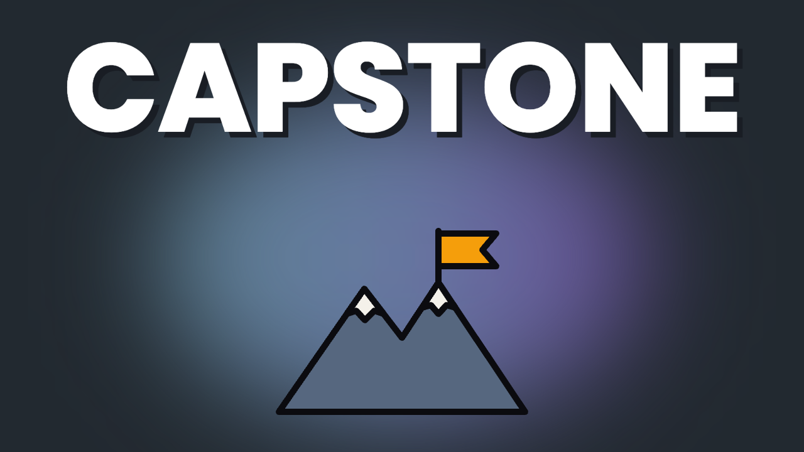
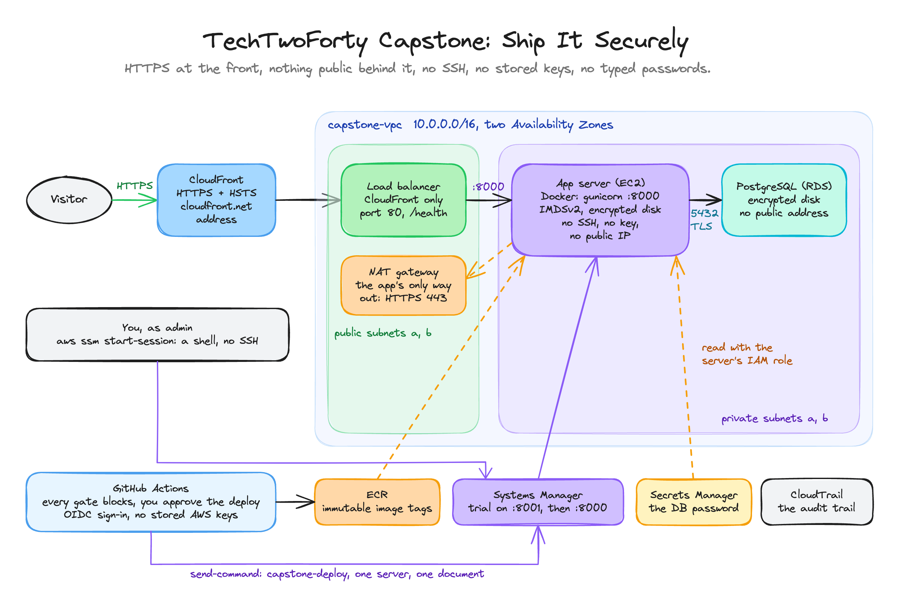

<p align="center">
  
</p>

<h1 align="center">TechTwoForty: Capstone</h1>
<p align="center"><b>Ship It Securely</b> · the finished project</p>
<p align="center">
  <a href="https://github.com/wjpearce-github/TechTwoForty-AI">← Previous: AI</a> ·
  <a href="https://github.com/wjpearce-github/TechTwoForty-Start-Here">Course map</a>
</p>

> [!TIP]
> **This repo is the finished template for the Capstone. Treat it as your cheat sheet.**
> It is your `devsecops-capstone` repo at the end of Stage 6: the notes app, the secure-by-default infrastructure (43 resources), the pipeline with a human-approved deploy, the risk register and the README that explains it all. Every file is exactly what the six stages produce, including the Permissions-Policy fix from Stage 5. The infrastructure passes `terraform fmt -check` and `terraform validate`, and the app's 3 tests pass.

| | |
|---|---|
| **Section** | 10 of 10 · The whole course |
| **Time** | About 5 to 6 hours, over a few sittings, 6 stages |
| **Runs on** | Your VM, GitHub and your AWS account |
| **Cost** | About **$0.12 an hour** while it is up. `terraform -chdir=infra destroy` when you stop |
| **Deliverable** | A live HTTPS app that only your pipeline can change, a README that explains every security decision, the evidence that it holds up, then an account with nothing running |

> [!WARNING]
> **GitHub Actions is switched off on this template repo.** There is no AWS account or `production` environment behind it. In **your** repo every push runs the gates, and every deploy waits for you.

## The big picture


<sub>Download as a PDF: <a href="assets/big-picture-diagram.pdf">big-picture-diagram.pdf</a></sub>

**This is how a change gets from your VM to production, and which module taught each part.** Every arrow is enforced by something, not remembered by someone.

- **The four phases across the top** map to the six stages: start from your own code (Stages 1 and 2), rebuild it secure by default (Stage 2), automate it so it cannot slip (Stage 3), then prove it, change it and tear it down (Stages 4 to 6).
- **Your VM** is where the work starts. You work on a branch with Claude Code and read every line of the diff, then run the same checks the pipeline will run (`pytest`, `semgrep`, `trivy`) before you push. Terraform runs from here too, and it builds everything in the AWS lane.
- **GitHub** is where nothing gets past. A pull request into the protected main branch runs the build job's eight gates. If any gate fails, the pull request cannot merge. Once it merges, the deploy job waits for your approval, signs in to AWS with OIDC (no stored keys), pushes the scanned image to ECR and has Systems Manager run the deploy on the server.
- **AWS** is the live environment. The deploy document tries the new image on port 8001, swaps it onto 8000 or rolls back, and a smoke test through CloudFront checks the commit ID. CloudTrail records every deploy and every Session Manager login.
- **The small tags on each box** (Git, Docker, Terraform, and so on) name the module that taught that part. The table in [Where every module shows up](#where-every-module-shows-up) says the same thing in words.

## The architecture


<sub>Download as a PDF: <a href="assets/architecture-diagram.pdf">architecture-diagram.pdf</a></sub>

**Read it left to right, the way a request travels.** The numbered steps on the right of the diagram follow one request:

1. A browser asks CloudFront for the page over HTTPS.
2. CloudFront passes it to the load balancer on port 80, and only CloudFront can, through AWS's own prefix list.
3. The load balancer sends it to the app server on port 8000, while `/health` passes.
4. The app reads the database password from Secrets Manager with its IAM role: nobody typed it, and it is not in Git or in Terraform state.
5. The app queries PostgreSQL on 5432 over TLS, and the page goes back the same way.

**Everything else on the page is every other way in or out, and there are not many.**

- **The network:** one VPC (`10.0.0.0/16`) across two availability zones, each with a public and a private subnet. The load balancer has a foot in both public subnets because it must. The app server and the database sit in the private ones, with no public IP. Zone B holds the spare subnet RDS requires, and room for a second app server later.
- **Outbound only:** the NAT gateway lets the server send HTTPS out (to ECR, Systems Manager, Secrets Manager and OS updates) and nothing back in.
- **The security group chain:** CloudFront's address list → `capstone-alb` on 80 → `capstone-app` on 8000 → `capstone-db` on 5432. Each rule names the next group, never an IP address. No rule anywhere opens port 22.
- **Two identities, no keys:** `capstone-app` is the server's role (Systems Manager agent, ECR pull, one secret). `capstone-deploy` is the pipeline's role, and only your repo's `production` environment can assume it.
- **Deploys and your shell** both ride the Systems Manager agent's own outbound connection, so there is no inbound port for either.
- **What is deliberately missing:** no bastion, no SSH, no public IP on the server or database, no password in code, Git, an image or state, no AWS access key in GitHub, no image tag that can move, and no deploy without a person saying yes.

<details>
<summary>The simpler version of the architecture diagram (Excalidraw)</summary>



<sub>Drawn in Excalidraw. To edit it, open <code>assets/diagram.excalidraw</code> at <a href="https://excalidraw.com">excalidraw.com</a>.</sub>

</details>

## What is in this repo

```text
devsecops-capstone/                         (this template repo)
├── .github/workflows/
│   ├── pipeline.yml          Stage 3: pinned actions, every gate, approved deploy, smoke test
│   └── benchmark.yml         Weekly Prowler CIS benchmark (Security section)
├── .gitignore
├── .trivyignore.yaml         Stage 2: the risk register, 4 accepted findings, each tied to one file
├── gates.md                  Stage 3: every check, where it runs, block or report
├── app/                      Stage 1 (+ Stage 5's Permissions-Policy header)
│   ├── app.py                Flask notes app: Secrets Manager, parameterised SQL, security headers
│   ├── templates/index.html  Jinja escapes every note. The nosemgrep CSRF decision is written here
│   ├── static/style.css
│   ├── test_app.py           3 tests, one of them a security test
│   ├── requirements.txt      flask, gunicorn, psycopg, boto3, all pinned
│   ├── Dockerfile            Multi-stage, non-root, gunicorn
│   ├── .dockerignore
│   └── docker-compose.yml    App + Postgres with a healthcheck, for local work
├── infra/                    Stage 2: one file per job
│   ├── backend.tf            Unchanged from the Terraform project
│   ├── versions.tf           Provider pinned, default Project tag
│   ├── variables.tf          region, github_subject
│   ├── network.tf            VPC, 2 public + 2 private subnets, NAT, route tables
│   ├── security.tf           The security group chain: CloudFront > ALB > app > db
│   ├── database.tf           RDS, encrypted, private, RDS-managed password
│   ├── compute.tf            EC2: IAM role, IMDSv2, encrypted disk, no key, no public IP
│   ├── user_data.sh          Installs Docker, writes app.env (no password), disables sshd
│   ├── edge.tf               Load balancer + CloudFront with managed security headers
│   ├── deploy.tf             ECR (immutable), the SSM document, the OIDC deploy role
│   ├── deploy-document.yaml  Trial on :8001, swap to :8000, roll back if it fails
│   ├── outputs.tf
│   └── terraform.tfvars.example   Copy to terraform.tfvars (gitignored)
├── docs/example-README.md    The README you write in Stage 6, for your own repo's front page
├── policies/project_tag.yaml
├── tools/dojo_import.py
└── reference/pre-commit      Your .git/hooks/pre-commit
```

> [!NOTE]
> In your repo, Stage 6's README **is** `README.md`, and Terraform's `.terraform.lock.hcl` is committed next to `infra/`. It is generated by `terraform init` on your machine, so it is not in this template.

## The six stages at a glance

| Stage | You build | Proof it worked |
|---|---|---|
| **0 · Start here** | Preflight: repo, Trivy 0.70+, Docker, Terraform, Semgrep, OIDC provider, branch rule | Every check prints a version or `Online` |
| **1 · The app** | Notes app, pinned deps, 3 tests, production image, Compose with Postgres | `3 passed`, a script tag shows as text, scans clean |
| **2 · The infrastructure** | 12 new files in `infra/`, the risk register, `apply` | `Plan: 43 to add`, the gated IaC scan exits 0, the server is `Online` in SSM |
| **3 · Ship it** | `production` environment, the finished pipeline, the first approved deploy | `Live: <url> is serving <commit>` |
| **4 · Prove it** | Headers, closed doors, a shell with no SSH, ZAP, CloudTrail, your Scripting auditor | 301, 5 headers, timeout on the ALB, no port 22, metadata `401`, `FAIL-NEW: 0` |
| **5 · Change it safely** | An AI-written fix, a back door the gates refuse, a broken release, a revert | IaC gate blocks AWS-0107; the broken image "failed its trial" and the site never went down |
| **6 · Hand over** | The README, checked against the code by Claude Code, then `destroy` | `43 destroyed`, and seven teardown checks come back empty |

## Cheat sheet: the commands you will use most

```bash
# Local: test and scan before you push (Stage 1)
. .venv/bin/activate && pytest -q app/
trivy fs --scanners vuln,secret --severity HIGH,CRITICAL app/
semgrep --config auto app/

# Infrastructure (Stage 2)
terraform -chdir=infra init -upgrade && terraform -chdir=infra fmt -check && terraform -chdir=infra validate
trivy config --severity HIGH,CRITICAL --ignorefile .trivyignore.yaml --exit-code 1 infra/; echo "exit code: $?"
terraform -chdir=infra plan
terraform -chdir=infra apply

# Your repo's OIDC subject for terraform.tfvars (Stage 2, phase 4)
curl -s https://api.github.com/repos/yourname/devsecops-capstone | python3 -c "import sys, json; r = json.load(sys.stdin); print('repo:%s@%s/%s@%s' % (r['owner']['login'], r['owner']['id'], r['name'], r['id']))"

# Prove it (Stage 4)
URL=$(terraform -chdir=infra output -raw app_url) && DOMAIN=$(echo "$URL" | sed "s#https://##")
curl -sI "http://$DOMAIN/" | grep -iE "^(HTTP|location)"     # 301 to https
curl -sI "$URL/"                                              # the five security headers
aws ssm start-session --target $(terraform -chdir=infra output -raw instance_id)

# Stop the bill, every time you stop for the day
terraform -chdir=infra destroy
```

Coming back after a destroy: `terraform -chdir=infra apply`, then GitHub, Actions, CI/CD Pipeline, **Run workflow** on main, and approve the deploy. About 20 minutes.

## Where every module shows up

| Module | What it gives the capstone |
|---|---|
| [Linux](https://github.com/wjpearce-github/TechTwoForty-Linux) | The shell on your VM and the server: `ss`, `curl`, `getent`, `systemctl`, a settings file only root can read |
| [Scripting](https://github.com/wjpearce-github/TechTwoForty-Scripting) | The Python app and its tests, and your auditor in Stage 4 |
| [Cloud](https://github.com/wjpearce-github/TechTwoForty-Cloud) | VPC, IAM roles, Secrets Manager, CloudTrail |
| [Terraform](https://github.com/wjpearce-github/TechTwoForty-Terraform) | All of `infra/`: remote state, references, `depends_on`, outputs, destroy and rebuild |
| [Docker](https://github.com/wjpearce-github/TechTwoForty-Docker) | The multi-stage, non-root image and the Compose stack |
| [Git](https://github.com/wjpearce-github/TechTwoForty-Git) | The repo, branch protection, pull requests, and a revert when a change goes wrong |
| [CI/CD](https://github.com/wjpearce-github/TechTwoForty-CICD) | The pipeline, OIDC, artifacts, and the production environment with its approval |
| [Security](https://github.com/wjpearce-github/TechTwoForty-Security) | Semgrep, Trivy and ZAP, and the habit of fixing or accepting in writing |
| [AI](https://github.com/wjpearce-github/TechTwoForty-AI) | A real fix written with Claude Code, reviewed by you, verified by the pipeline |

## The risk register

Accepted at HIGH and CRITICAL, with the reasons in [`.trivyignore.yaml`](.trivyignore.yaml):

| Check | Finding | Why it is accepted |
|---|---|---|
| AWS-0053 | Load balancer is internet-facing | CloudFront has to reach it. Its security group only lets in CloudFront's address list |
| AWS-0054 | Load balancer listens on HTTP | Visitors get HTTPS from CloudFront. HTTPS on the ALB needs a domain you own |
| AWS-0011 | No WAF in front of CloudFront | Billed monthly even when idle. The first thing to add for a real service |
| AWS-0104 | App server can send HTTPS anywhere | Needed for ECR, SSM and Secrets Manager through the NAT. Port 443 only |
| Semgrep, ZAP | No anti-CSRF token on the form | No logins and no cookies, so a forged request can do nothing an attacker could not do directly |

Anything else at HIGH or CRITICAL fails the pipeline. That is why the Stage 5 "quick SSH for debugging" rule (AWS-0107) is refused.

## Final handover check

- [ ] A visitor gets the app over HTTPS, and plain HTTP is redirected
- [ ] The server and database have no public address, and nothing listens for SSH
- [ ] The database password was never typed, and is not in Git or in Terraform's state
- [ ] Every action is pinned to a commit ID, and every scanner is a gate
- [ ] Every accepted finding is written down with a reason
- [ ] Only main can deploy, only after your approval, with no stored AWS keys
- [ ] A broken release failed its trial and never went live
- [ ] The README explains the system, its controls and its risks
- [ ] `terraform destroy` left nothing billing

## Common mistakes

| Mistake | What happens | The fix |
|---|---|---|
| `github_subject` does not match what GitHub sends | `Not authorized to perform sts:AssumeRoleWithWebIdentity` | Print the subject again, fix `terraform.tfvars`, `apply`, re-run failed jobs |
| The environment is not called exactly `production` | The deploy role does not trust the job | Rename it `production` |
| Opening the PR before Stage 3 | The old pipeline fails on the new app | Stages 1 to 3 land together, in one PR |
| `terraform fmt -check` prints a file name | The pipeline's Terraform gate fails | `terraform -chdir=infra fmt`, commit, push |
| An old Trivy (before 0.70) | Check IDs do not match the risk register | `sudo apt install --only-upgrade -y trivy` |
| Leaving it up overnight | About $90 a month if forgotten | `terraform -chdir=infra destroy` |

## What you can now do

- **Secure by design:** private by default, one port per link, no standing access, secrets nobody types
- **Infrastructure as code:** a production environment built, scanned, destroyed and rebuilt from one repo
- **Supply chain security:** pinned dependencies and actions, scanned images, tags that cannot move
- **Continuous delivery:** gated builds, approved deploys, a trial before every release, a clean way back
- **Verification:** header and network checks, a DAST scan and an audit trail, against the live system
- **Judgement:** fix it, or accept it and write down why, every time
- **Working with AI:** scoped tasks, every diff read, tools that verify the result

That is the course.

---

<p align="center">
  <b>TechTwoForty</b> · Capstone · 10 of 10<br>
  <a href="https://github.com/wjpearce-github/TechTwoForty-AI">← Previous: AI</a> ·
  <a href="https://github.com/wjpearce-github/TechTwoForty-Start-Here">Course map</a>
</p>
