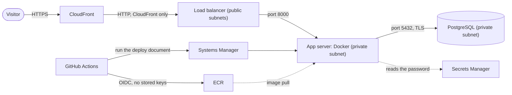

# DevSecOps Capstone

A small notes app running in AWS behind HTTPS, with no SSH, no stored keys and no secrets in Git. Every change is tested, scanned and approved before it reaches production, and the whole environment can be destroyed and rebuilt from this repo.


## How it fits together



| Folder | What is in it |
|---|---|
| `app/` | The Flask app, its tests, a multi-stage Dockerfile that runs as a non-root user, and a Compose file for local work |
| `infra/` | Terraform for the network, security groups, database, server, load balancer, CloudFront and the deploy plumbing |
| `.github/workflows/pipeline.yml` | Build, test, scan, then a human-approved deploy |
| `.trivyignore.yaml` | The risk register: scanner findings that were accepted, each tied to one file, with a reason |

## What protects it

| Risk | What stops it |
|---|---|
| Someone reaches the server or the database directly | Both sit in private subnets with no public address. Security groups chain CloudFront to the load balancer to the app to the database, one port per link. |
| Traffic is read on the way | HTTPS from the visitor to CloudFront, with Strict-Transport-Security. TLS from the app to the database. |
| A stolen password or key | No SSH and no key pairs: admin access is Session Manager. RDS generates the database password and keeps it in Secrets Manager. The pipeline has no AWS keys: it uses OIDC. |
| A bad change reaches production | Pull requests only. Tests, SAST, dependency, secret, IaC and image scans must pass. A person approves every deploy, and each new version is tried next to the live one before it takes over. |
| A poisoned tool in the pipeline | Every action is pinned to a full commit ID. The deploy role can push to one repository and run one document on one server, nothing else. |
| Malicious input in a note | Jinja escapes every note, SQL uses parameters, and the Content-Security-Policy blocks inline scripts. |
| Nobody knows what changed | CloudTrail records every deploy and every Session Manager login. |

## Risk register

Accepted, with reasons in `.trivyignore.yaml`:

| Check | Finding | Why it is accepted |
|---|---|---|
| AWS-0053 | Load balancer is internet-facing | CloudFront has to reach it. Its security group only lets in CloudFront's address list. |
| AWS-0054 | Load balancer listens on HTTP | Visitors get HTTPS from CloudFront. HTTPS on the load balancer needs a domain. |
| AWS-0011 | No WAF in front of CloudFront | Billed monthly even when idle. First thing to add for a real service. |
| AWS-0104 | App server can send HTTPS anywhere | Needed for ECR, Systems Manager and Secrets Manager through the NAT. Port 443 only. |
| Semgrep, ZAP | No anti-CSRF token on the form | The app has no logins or cookies, so a forged request can do nothing an attacker could not do directly. |

Next improvements, found by the scanners at MEDIUM and LOW and deliberately deferred:

- VPC flow logs (AWS-0178) and CloudFront access logs (AWS-0010)
- RDS deletion protection (AWS-0177), off so that `terraform destroy` works, and longer backups (AWS-0077)
- RDS IAM authentication (AWS-0176) and Performance Insights (AWS-0133)
- A customer-managed KMS key for ECR (AWS-0033)
- Verify the database certificate (`sslmode=verify-full`) instead of only requiring TLS
- A custom domain with an ACM certificate, then HTTPS all the way to the load balancer
- A second app server in the other Availability Zone, and Multi-AZ RDS
- Make sure only this site's own CloudFront distribution can reach the load balancer: a secret header that CloudFront adds and the load balancer checks, or CloudFront VPC origins with a private load balancer
- Pin every dependency, including the ones the libraries pull in, with a lock file
- Tighter server permissions: replace the two AWS-managed policies with my own (the Systems Manager one can read any Parameter Store value, the ECR one can pull from any repository), and give the app its own database user instead of the master user

## Run it

You need the AWS CLI signed in, Terraform, and `infra/terraform.tfvars` containing `github_subject = "repo:yourname@OWNER_ID/devsecops-capstone@REPO_ID"`, the subject GitHub sends for this repo.

```bash
terraform -chdir=infra init
terraform -chdir=infra apply
```

Then deploy: GitHub, Actions, CI/CD Pipeline, Run workflow on main, and approve the production deployment.

Tear it all down when you stop. It costs roughly $0.12 an hour while it is up.

```bash
terraform -chdir=infra destroy
```
